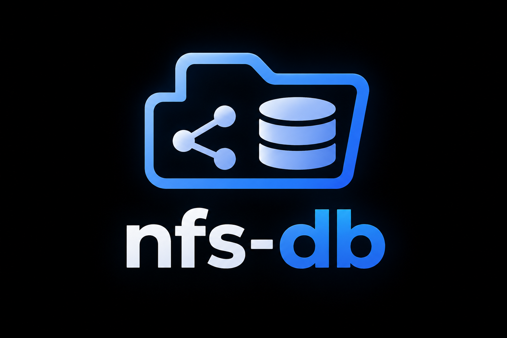

# nfs-db

nfs-db is *not* a database engine. It is a lightweight Python interface that lets you interact with an existing NFS server through familiar database-style operations.

### Why nfs-db?

For small projects already utilizing a NFS server, using nfs-db avoids the infrastructure complexity and operational requirements that traditional databases bring.

### What to expect

nfs-db is not intended to compete with traditional database engines. Filesystem operations introduce overhead, and performance will not be comparable to purpose-built database systems.

nfs-db is best suited for:

- Small applications and utilities.
- Shared application state across multiple machines.
- Data processing pipelines operating on shared NFS storage.
- Workloads where atomic operations matter more than raw throughput.

It is not intended for large datasets, high-throughput workloads, or applications requiring the advanced capabilities of a traditional database.

## Quickstart

Create a users table:

```python
from nfs_db import database, table_spec

db = database("/mnt/nfs")
spec = table_spec("users", name=str, number=int, is_active=bool)
users = db.table(spec)
```

Insert, retrieve, update, query, and delete rows:

```python
row_id = users.insert({
    "name": "John",
    "number": 7,
    "is_active": True,
})

row = users.get(row_id)
active_users = users.get_where("is_active", True)

users.update(row_id, lambda row: {**row, "number": row["number"] + 1})
users.delete(row_id)
```

The update callback must return a row dictionary with the table's existing
fields, and it must not change `id`. If another update wins a race, the callback
may run again against the latest row, so avoid external side effects in it.
